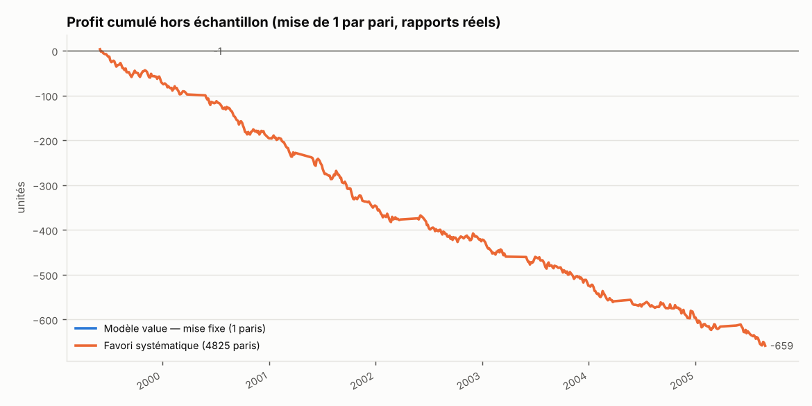
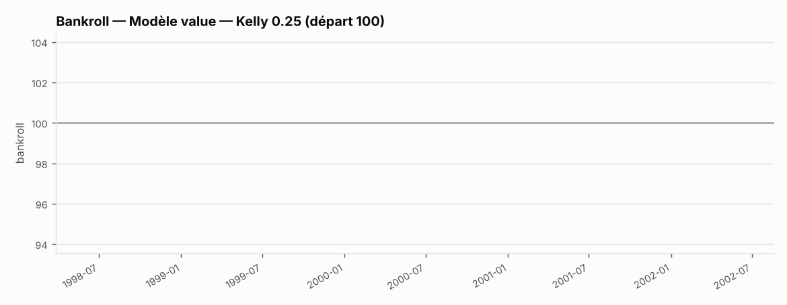
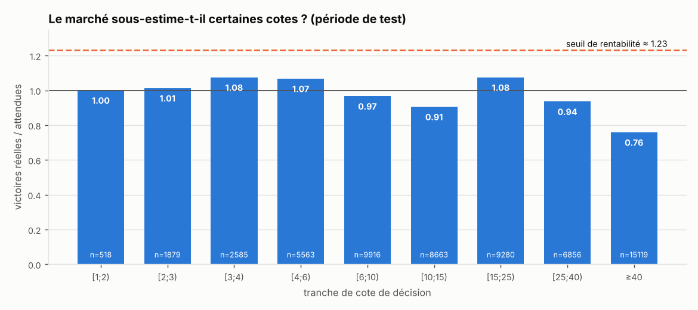

# Rapport de backtest — Hong Kong 1997–2005 (cote finale)

## Verdict

**Le modèle ne trouve presque jamais de valeur** (1 pari(s) sur toute la période de test). Ses probabilités restent collées à celles du marché (écart de log-vraisemblance +0.0000 par course, IC 90 % [-0.0016 ; +0.0016]) : avec la marge de sécurité demandée, aucun cheval n'est assez sous-coté. Le tableau de sensibilité montre ce que donnent des marges plus faibles.

> ⚠️ **Les cotes de décision de ce jeu sont les cotes FINALES** (aucune cote antérieure au départ n'est disponible). Les résultats sont donc un majorant optimiste : en pratique, personne ne connaît la cote finale au moment de parier.

## Données

- Période : 1997-06-02 → 2005-08-28 (682 jours de courses)
- 6320 courses, 79129 partants
- Disciplines : {'PLAT_GAZON': 5630, 'PLAT_PSF': 690}
- Somme médiane des 1/cote par course : 1.231 → taux de retour implicite ≈ 81.3 % (prélèvement + arrondi ≈ 18.7 %)

## Protocole (aucune information du futur)

- Validation chronologique par plis de 91 jours ; fenêtre croissante, au moins 730 jours d'entraînement avant le premier test.
- 26 plis ; période de test : 1999-06-02 → 2005-08-28 (4825 courses jamais vues par le modèle au moment de la prédiction).
- Dans chaque pli : étape 1 (modèle fondamental, sans cotes) entraînée sur la partie ancienne de la fenêtre, étape 2 (combinaison avec le marché) sur les 30 % les plus récents.
- Décision prise avec `cote_decision` ; gain calculé avec le **rapport réellement payé** (prélèvement inclus). Le rapport attendu tient compte de la dérive habituelle des cotes entre la décision et le départ.
- Sélection : cote ∈ [cote_min apprise dans chaque pli sur ses seules données d'entraînement (2) ; 40], EV ≥ 10 %, p ≥ 0.03, au plus 1 cheval par course. Une course sans valeur n'est pas jouée.
- Remise sur mises : 0 % ; commission sur gains : 0 %.

## Comparaison des stratégies (mêmes courses de test)



| strategie                               |   paris |   courses_jouees |   profit |   roi_pct | roi_ic90_pct                  |   proba_roi_negatif |   taux_reussite_pct |   cote_moy_paris |   rapport_moy_gagnants |   drawdown_max |   serie_perdante_max |   bankroll_finale |   drawdown_max_pct |
|:----------------------------------------|--------:|-----------------:|---------:|----------:|:------------------------------|--------------------:|--------------------:|-----------------:|-----------------------:|---------------:|---------------------:|------------------:|-------------------:|
| Modèle value — mise fixe                |       1 |                1 |    -1    |   -100    | [-100.0 ; -100.0]             |                   1 |                0    |             5.1  |                 nan    |           1    |                    1 |            nan    |             nan    |
| Modèle value — Kelly 0.25               |       1 |                1 |    -1.01 |   -100    | [-100.0 ; -100.0]             |                   1 |                0    |             5.1  |                 nan    |           1.01 |                    1 |             98.99 |               1.01 |
| Marché seul value — mise fixe           |       0 |              nan |   nan    |    nan    | nan                           |                 nan |              nan    |           nan    |                 nan    |         nan    |                  nan |            nan    |             nan    |
| Favori systématique                     |    4825 |             4825 |  -658.5  |    -13.65 | [-17.0 ; -10.3]               |                   1 |               30.18 |             3.08 |                   2.86 |         663.2  |                   27 |            nan    |             nan    |
| Tous les chevaux dans la plage de cotes |   45058 |             4825 | -8232.05 |    -18.27 | [-19.9 ; -16.7]               |                   1 |                9.89 |            13.81 |                   8.26 |        8287.4  |                   34 |            nan    |             nan    |
| Hasard (1 cheval/course)                |    4825 |             4825 | -1544.55 |    -23.7  | [-33.8 ; -12.7] (simulations) |                   1 |                8.06 |            28.62 |                   8.43 |        1563.65 |                   83 |            nan    |             nan    |
| Hasard dans la plage de cotes           |    4825 |             4825 |  -906.8  |    -17.77 | [-24.9 ; -10.4] (simulations) |                   1 |               10.09 |            13.86 |                   8.05 |         994.2  |                   47 |            nan    |             nan    |

Lecture : `roi_ic90_pct` est l'intervalle de confiance à 90 % du ROI (bootstrap des jours) ; `proba_roi_negatif` la proportion de rééchantillonnages où le ROI est ≤ 0. Pour le hasard, moyenne de 2000 simulations.



## Le modèle bat-il le marché ?

Log-vraisemblance moyenne par course sur la période de test (plus haut = meilleures probabilités) :

| modele                         |   logvrais_par_course |
|:-------------------------------|----------------------:|
| Marché brut (1/cote normalisé) |              -2.04088 |
| Marché recalibré               |              -2.04008 |
| Fondamental seul (sans cotes)  |              -2.25377 |
| Modèle complet                 |              -2.04083 |

- Écart modèle complet − cotes brutes : **+0.0000** par course, IC 90 % [-0.0016 ; +0.0016]
- Écart modèle complet − marché recalibré : -0.0008, IC 90 % [-0.0016 ; +0.0001]

Repère : chez Benter (Hong Kong, 1994), l'apport du modèle sur le marché était modeste (pseudo-R² 0,1218 → 0,1396) et suffisait pourtant à être rentable. Un écart dont l'intervalle contient 0 signifie qu'aucun apport n'est démontré.

Coefficients du dernier pli (variables standardisées) :

```json
{
 "etape1": {
  "corde_rel_plat": -0.1708,
  "poids_rel": 0.0218,
  "valeur_handicap_rel": 0.0105,
  "age_rel": 0.0638,
  "jk_n": 0.013,
  "jk_ae": 0.0091,
  "jk_tv": 0.2183,
  "ent_n": -0.0716,
  "ent_ae": -0.0388,
  "ent_tv": 0.1064,
  "chv_jours_repos": -0.0443,
  "chv_pos_rel_prec": -0.2361,
  "chv_pos_rel_moy3": -0.3857,
  "chv_nb_courses": -0.2331,
  "chv_victoires_ant": 0.0441,
  "chv_surplus_marche": -0.0407,
  "chv_ecart_prec": 0.0606,
  "chv_ecart_moy3": -0.1376,
  "chv_var_poids_corps": -0.0216,
  "chv_var_distance": -0.0138,
  "chv_var_valeur": 0.0054,
  "chv_jours_repos__manquant": -0.0096,
  "chv_pos_rel_prec__manquant": -0.0096,
  "chv_pos_rel_moy3__manquant": -0.0096,
  "chv_surplus_marche__manquant": -0.0096,
  "chv_ecart_prec__manquant": -0.0096,
  "chv_ecart_moy3__manquant": -0.0096,
  "chv_var_poids_corps__manquant": -0.0096,
  "chv_var_distance__manquant": -0.0096,
  "chv_var_valeur__manquant": -0.0096
 },
 "etape2": {
  "score_fondamental": -0.065,
  "log_q (écart à 1)": 0.1034
 }
}
```

## Justification du seuil de cote minimale

Calculée sur les données **antérieures au premier test** (1997-06-02 → 1999-06-01), selon une règle fixée à l'avance : on exclut les tranches de petites cotes consécutives où le marché ne sous-estime pas les chevaux (réel/attendu ≤ 1).

| tranche   |   partants |   victoires |   attendues |   reel_sur_attendu |   roi_tous_pct |
|:----------|-----------:|------------:|------------:|-------------------:|---------------:|
| [1;2)     |        165 |          84 |        80.5 |              1.043 |          -15.3 |
| [2;3)     |        581 |         200 |       190   |              1.053 |          -14   |
| [3;4)     |        702 |         152 |       166.5 |              0.913 |          -25.2 |
| [4;6)     |       1655 |         265 |       274.7 |              0.965 |          -20.7 |
| [6;10)    |       3148 |         370 |       334   |              1.108 |           -9.5 |
| [10;15)   |       2808 |         199 |       194.8 |              1.021 |          -14.1 |
| [15;25)   |       3175 |         114 |       139.3 |              0.818 |          -31.1 |
| [25;40)   |       2462 |          69 |        65.4 |              1.055 |          -13.3 |
| ≥40       |       4054 |          43 |        49.6 |              0.866 |          -29.7 |

→ Seuil suggéré par les données : **2**. Seuil réellement appliqué : cote_min apprise dans chaque pli sur ses seules données d'entraînement (2).

Même tableau sur la période de test (contrôle, pas utilisé pour choisir) :



| tranche   |   partants |   victoires |   attendues |   reel_sur_attendu |   roi_tous_pct |
|:----------|-----------:|------------:|------------:|-------------------:|---------------:|
| [1;2)     |        518 |         249 |       248.6 |              1.002 |          -17.7 |
| [2;3)     |       1879 |         625 |       616.1 |              1.014 |          -17.1 |
| [3;4)     |       2585 |         659 |       612.5 |              1.076 |          -12.3 |
| [4;6)     |       5563 |         991 |       927.3 |              1.069 |          -13.1 |
| [6;10)    |       9916 |        1016 |      1049.2 |              0.968 |          -21.5 |
| [10;15)   |       8663 |         547 |       602.8 |              0.907 |          -23.3 |
| [15;25)   |       9280 |         441 |       409.7 |              1.076 |          -10.5 |
| [25;40)   |       6856 |         171 |       182.4 |              0.937 |          -24.9 |
| ≥40       |      15119 |         134 |       176.4 |              0.76  |          -40.7 |

`roi_tous_pct` : ROI obtenu en pariant TOUS les chevaux de la tranche aux rapports réels. Un réel/attendu supérieur à ≈ 1.23 serait nécessaire pour être rentable.

## Dérive de la cote entre la décision et le départ (gagnants)

| tranche   |   gagnants |   ratio_moyen |   ratio_median |
|:----------|-----------:|--------------:|---------------:|
| [1;2)     |        249 |         1.018 |          1.026 |
| [2;3)     |        625 |         1.01  |          1.017 |
| [3;4)     |        659 |         1.004 |          1.013 |
| [4;6)     |        991 |         1.003 |          1     |
| [6;10)    |       1016 |         1.001 |          1     |
| [10;15)   |        547 |         1.037 |          1.036 |
| [15;25)   |        441 |         1.022 |          1.025 |
| [25;40)   |        171 |         1.013 |          1.017 |
| ≥40       |        134 |         1.058 |          1.008 |

Un ratio médian < 1 : le gagnant paie moins que la cote vue au moment de parier (l'argent tardif fait baisser les cotes des chevaux qui gagnent).

## Sensibilité aux paramètres (descriptif)

ROI en mise fixe selon la cote minimale (lignes) et la marge d'EV (colonnes), nombre de paris entre parenthèses. **Choisir la meilleure case de ce tableau serait du surajustement** : il montre seulement la stabilité.

|   cote_min | 0.0          | 0.05         | 0.1          | 0.2   | 0.3   |
|-----------:|:-------------|:-------------|:-------------|:------|:------|
|          1 | -14.9 % (56) | -66.0 % (10) | -100.0 % (1) | —     | —     |
|          2 | -16.9 % (55) | -66.0 % (10) | -100.0 % (1) | —     | —     |
|          3 | -10.4 % (48) | -62.2 % (9)  | -100.0 % (1) | —     | —     |
|          4 | -18.2 % (40) | -100.0 % (7) | -100.0 % (1) | —     | —     |
|          6 | -18.8 % (28) | -100.0 % (5) | —            | —     | —     |
|          8 | -50.6 % (18) | -100.0 % (5) | —            | —     | —     |

## Exploration puis confirmation

Trop peu de paris en exploration.

## Patterns : situations sous-cotées par le marché ?

Entraînement avant le 2002-06-02, test ensuite. A/E = victoires réelles / attendues selon les cotes. Retenu si significatif après correction de Benjamini-Hochberg (α = 0.1) ; validé seulement si A/E > 1 et ROI > 0 en test.

| pattern                                                  |   n_entr |   AE_entr |   roi_pct_entr |   z_entr | retenu_entr_BH   |   n_test |   AE_test |   roi_pct_test | valide_test   |
|:---------------------------------------------------------|---------:|----------:|---------------:|---------:|:-----------------|---------:|----------:|---------------:|:--------------|
| Valeur handicap en baisse                                |     1300 |     1.193 |           -4.6 |     1.78 | False            |    10508 |     1.096 |          -18.5 | False         |
| Recourt dans les 10 jours                                |     3055 |     1.092 |          -13.8 |     1.52 | False            |     1846 |     1.125 |           -5.4 | False         |
| A fait mieux que ses cotes (surplus passé > 0)           |    12158 |     1.024 |          -18   |     1    | False            |     8551 |     1.049 |          -17.7 | False         |
| Jockey/driver historiquement sur-coté (A/E passé < 0,8)  |     3329 |     1.051 |          -13.3 |     0.73 | False            |     1563 |     0.98  |          -27.6 | False         |
| Plat, corde extérieure (dernier tiers)                   |    16737 |     1.019 |          -20.3 |     0.69 | False            |    11290 |     1.079 |          -15.1 | False         |
| Outsider 10-25 dans un petit peloton (≤ 8)               |      155 |     1.208 |            9.7 |     0.65 | False            |      102 |     1.057 |            5   | False         |
| 2e favori                                                |     3786 |     1.017 |          -17.9 |     0.48 | False            |     2556 |     1.002 |          -18.7 | False         |
| Plat, corde intérieure (1er tiers)                       |    16536 |     1.008 |          -23.8 |     0.37 | False            |    11110 |     0.969 |          -31.8 | False         |
| Entraîneur historiquement sous-coté (A/E passé > 1,2)    |     2368 |     1.017 |          -27.4 |     0.28 | False            |      514 |     1.047 |          -20.1 | False         |
| Absent depuis > 60 jours                                 |     5804 |     1.01  |          -22   |     0.23 | False            |     4466 |     1.057 |          -23   | False         |
| Jockey/driver historiquement sous-coté (A/E passé > 1,2) |     3084 |     1.005 |          -25   |     0.09 | False            |     1396 |     0.98  |          -30.9 | False         |
| Changement de distance > 15 %                            |    15198 |     0.972 |          -24.7 |    -0.98 | False            |     9895 |     1.007 |          -28.2 | False         |

→ **0 pattern(s) validé(s) hors échantillon** sur 12 testés.

## Limites

- En pari mutuel, la cote finale n'est connue qu'après le départ et votre propre mise la fait baisser (négligeable pour de petites mises sur des masses de plusieurs milliers d'euros, pas pour des courses à faible enjeu).
- Le nombre de paris nécessaire pour prouver un avantage est très élevé aux cotes moyennes jouées : ≈ 6 301 paris pour distinguer +5 % de 0.
- Les hyperparamètres (pénalités, marge, seuils) sont fixés a priori ; aucune optimisation n'a été faite sur la période de test.

Fichiers : `predictions_test.csv` (toutes les probabilités hors échantillon), `paris_fixe.csv`, `paris_kelly.csv`, `comparaison_strategies.csv`.