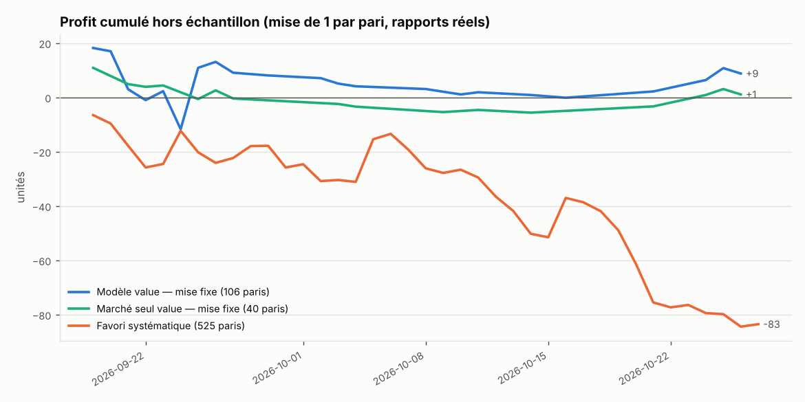
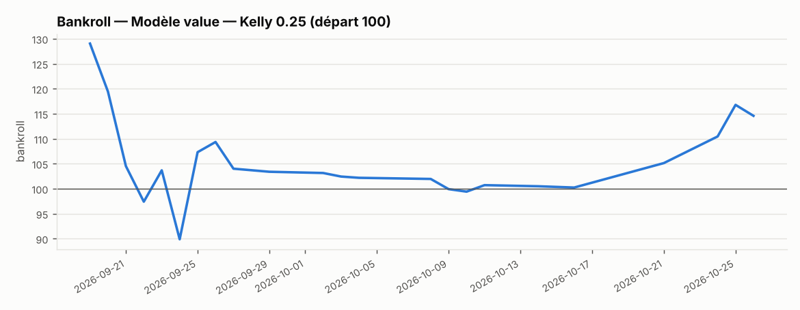
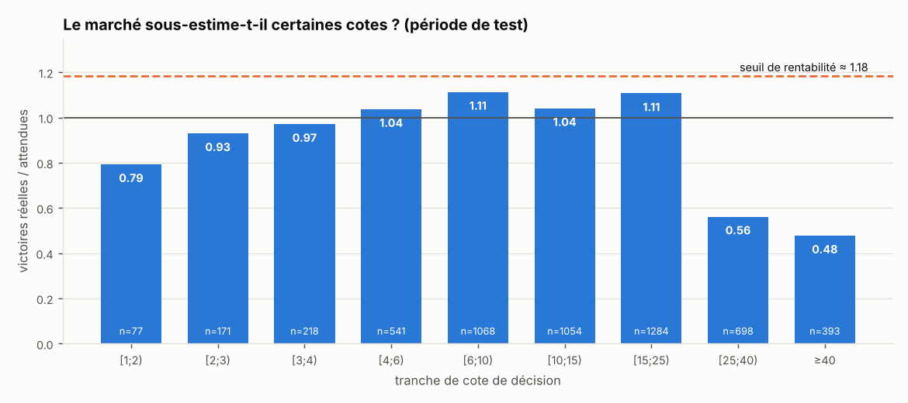

# Rapport de backtest — PMU France — PLAT (août–oct. 2026, cote T-15)

## Verdict

**Pas de rentabilité démontrée.** Le ROI hors échantillon du modèle est de +8.3 % sur 106 paris, avec un intervalle de confiance à 90 % de [-48.2 ; 65.3] % : la vraie valeur peut aussi bien être fortement négative que positive. L'écart de log-vraisemblance du modèle par rapport aux cotes brutes est de -0.0140 par course (IC 90 % [-0.0251 ; -0.0027]) : le modèle n'apporte pas d'information prouvée au-delà du marché. Pour distinguer un ROI de +5 % de zéro à la cote moyenne jouée, il faudrait environ 12 985 paris.


## Données

- Période : 2026-08-29 → 2026-10-27 (58 jours de courses)
- 743 courses, 7838 partants
- Disciplines : {'PLAT': 743}
- Somme médiane des 1/cote par course : 1.185 → taux de retour implicite ≈ 84.4 % (prélèvement + arrondi ≈ 15.6 %)

## Protocole (aucune information du futur)

- Validation chronologique par plis de 7 jours ; fenêtre croissante, au moins 21 jours d'entraînement avant le premier test.
- 6 plis ; période de test : 2026-09-19 → 2026-10-27 (525 courses jamais vues par le modèle au moment de la prédiction).
- Dans chaque pli : étape 1 (modèle fondamental, sans cotes) entraînée sur la partie ancienne de la fenêtre, étape 2 (combinaison avec le marché) sur les 30 % les plus récents.
- Décision prise avec `cote_decision` ; gain calculé avec le **rapport réellement payé** (prélèvement inclus). Le rapport attendu tient compte de la dérive habituelle des cotes entre la décision et le départ.
- Disciplines : ['PLAT'] ; profil de variables : plat.
- Sélection : cote ∈ [cote_min apprise dans chaque pli sur ses seules données d'entraînement (3) ; cote_max apprise par pli (15, 25)], EV ≥ 10 %, p ≥ 0.03, au plus 1 cheval par course. Une course sans valeur n'est pas jouée.
- Remise sur mises : 0 % ; commission sur gains : 0 %.

## Comparaison des stratégies (mêmes courses de test)



| strategie                               |   paris |   courses_jouees |   profit |   roi_pct | roi_ic90_pct                 |   proba_roi_negatif |   taux_reussite_pct |   cote_moy_paris |   rapport_moy_gagnants |   drawdown_max |   serie_perdante_max |   bankroll_finale |   drawdown_max_pct |
|:----------------------------------------|--------:|-----------------:|---------:|----------:|:-----------------------------|--------------------:|--------------------:|-----------------:|-----------------------:|---------------:|---------------------:|------------------:|-------------------:|
| Modèle value — mise fixe                |     106 |              106 |     8.8  |      8.3  | [-48.2 ; 65.3]               |               0.418 |               15.09 |             9.45 |                   7.17 |          35.7  |                   26 |            nan    |             nan    |
| Modèle value — Kelly 0.25               |     106 |              106 |    14.59 |     12.1  | [-47.4 ; 70.9]               |               0.385 |               15.09 |             9.45 |                   7.17 |          43.57 |                   26 |            114.59 |              32.65 |
| Marché seul value — mise fixe           |      40 |               40 |     1.1  |      2.75 | [-53.3 ; 70.3]               |               0.486 |               20    |             8.84 |                   5.14 |          19.3  |                   10 |            nan    |             nan    |
| Favori systématique                     |     525 |              525 |   -83.5  |    -15.9  | [-28.2 ; -3.6]               |               0.983 |               26.86 |             3.31 |                   3.13 |          89.4  |                   14 |            nan    |             nan    |
| Tous les chevaux dans la plage de cotes |    3176 |              524 |  -574.8  |    -18.1  | [-22.4 ; -13.6]              |               1     |               11.68 |             9.22 |                   7.01 |         610.7  |                   52 |            nan    |             nan    |
| Hasard (1 cheval/course)                |     525 |              525 |  -178.1  |    -23.65 | [-45.0 ; -0.0] (simulations) |               0.95  |               10.1  |            16.36 |                   6.55 |         189.5  |                   79 |            nan    |             nan    |
| Hasard dans la plage de cotes           |     524 |              524 |  -116.8  |    -18.91 | [-36.3 ; -0.6] (simulations) |               0.955 |               11.26 |             9.18 |                   6.9  |         132.2  |                   36 |            nan    |             nan    |

Lecture : `roi_ic90_pct` est l'intervalle de confiance à 90 % du ROI (bootstrap des jours) ; `proba_roi_negatif` la proportion de rééchantillonnages où le ROI est ≤ 0. Pour le hasard, moyenne de 2000 simulations.



## Le modèle bat-il le marché ?

Log-vraisemblance moyenne par course sur la période de test (plus haut = meilleures probabilités) :

| modele                         |   logvrais_par_course |
|:-------------------------------|----------------------:|
| Marché brut (1/cote normalisé) |              -2.02157 |
| Marché recalibré               |              -2.02606 |
| Fondamental seul (sans cotes)  |              -2.46344 |
| Modèle complet                 |              -2.03555 |

- Écart modèle complet − cotes brutes : **-0.0140** par course, IC 90 % [-0.0251 ; -0.0027]
- Écart modèle complet − marché recalibré : -0.0095, IC 90 % [-0.0175 ; -0.0023]

Repère : chez Benter (Hong Kong, 1994), l'apport du modèle sur le marché était modeste (pseudo-R² 0,1218 → 0,1396) et suffisait pourtant à être rentable. Un écart dont l'intervalle contient 0 signifie qu'aucun apport n'est démontré.

Coefficients du dernier pli (variables standardisées) :

```json
{
 "etape1": {
  "mus_n": -0.1233,
  "mus_inedit": -0.0275,
  "mus_reprise": -0.2455,
  "mus_derniere": -0.0719,
  "mus_moy3": -0.0731,
  "mus_moy5": -0.0904,
  "mus_victoires5": 0.0527,
  "mus_top3_5": 0.0562,
  "mus_incidents5": -0.0318,
  "mus_meme_disc5": -0.0024,
  "mus_derniere_gagnee": -0.0072,
  "fer_DP": -0.0403,
  "oeilleres_oui": 0.0013,
  "corde_rel_plat": 0.031,
  "jk_n": 0.1586,
  "jk_ae": -0.0514,
  "jk_tv": 0.1557,
  "ent_n": 0.3644,
  "ent_ae": -0.1546,
  "ent_tv": 0.0692,
  "chv_nb_courses": 0.0017,
  "chv_victoires_ant": 0.0364,
  "chv_jours_repos": 0.0559,
  "chv_pos_rel_prec": -0.2395,
  "chv_pos_rel_moy3": 0.282,
  "chv_surplus_marche": -0.1083,
  "pl_corde_sprint": -0.0167,
  "pl_corde_grand_peloton": -0.1741,
  "pl_poids_rel_handicap": 0.026,
  "pl_valeur_rel_handicap": 0.1151,
  "pl_changement_jockey": -0.0957,
  "pl_forme_plat_moy3": -0.3105,
  "pl_victoire_plat_recente": -0.001,
  "pl_nb_courses_plat": -0.0384,
  "mus_derniere__manquant": -0.0275,
  "mus_moy3__manquant": -0.0275,
  "mus_moy5__manquant": -0.0275,
  "mus_victoires5__manquant": -0.0275,
  "mus_top3_5__manquant": -0.0275,
  "mus_incidents5__manquant": -0.0275,
  "mus_meme_disc5__manquant": -0.0275,
  "mus_derniere_gagnee__manquant": -0.0275,
  "chv_jours_repos__manquant": -0.0181,
  "chv_pos_rel_prec__manquant": -0.0181,
  "chv_pos_rel_moy3__manquant": -0.0181,
  "chv_surplus_marche__manquant": -0.0181,
  "pl_poids_rel_handicap__manquant": 0.0,
  "pl_valeur_rel_handicap__manquant": 0.0,
  "pl_changement_jockey__manquant": -0.0181,
  "pl_forme_plat_moy3__manquant": 0.0095,
  "pl_victoire_plat_recente__manquant": 0.0095
 },
 "etape2": {
  "score_fondamental": 0.0624,
  "log_q (écart à 1)": 0.1035,
  "derive_t90 (std)": -0.1738,
  "derive_t30 (std)": 0.0621,
  "pl_favori (std)": -0.048,
  "pl_rang_2_5 (std)": 0.0761,
  "pl_logq_x_peloton (std)": 0.0026
 }
}
```

## Justification du seuil de cote minimale

Calculée sur les données **antérieures au premier test** (2026-08-29 → 2026-09-18), selon une règle fixée à l'avance : on exclut les tranches de petites cotes consécutives où le marché ne sous-estime pas les chevaux (réel/attendu ≤ 1).

| tranche   |   partants |   victoires |   attendues |   reel_sur_attendu |   roi_tous_pct |
|:----------|-----------:|------------:|------------:|-------------------:|---------------:|
| [1;2)     |         38 |          19 |        20.5 |              0.925 |           -1.6 |
| [2;3)     |         66 |          18 |        23.3 |              0.773 |          -32   |
| [3;4)     |         77 |          24 |        18.7 |              1.281 |           15.1 |
| [4;6)     |        202 |          41 |        34.5 |              1.188 |          -10.8 |
| [6;10)    |        462 |          53 |        50.7 |              1.045 |          -19.5 |
| [10;15)   |        458 |          31 |        32.7 |              0.948 |          -18.6 |
| [15;25)   |        589 |          24 |        26.9 |              0.891 |          -21   |
| [25;40)   |        286 |           7 |         8   |              0.875 |          -20.8 |
| ≥40       |        156 |           2 |         2.6 |              0.774 |          -14.8 |

→ Seuil suggéré par les données : **3**. Seuil réellement appliqué : cote_min apprise dans chaque pli sur ses seules données d'entraînement (3).

Même tableau sur la période de test (contrôle, pas utilisé pour choisir) :



| tranche   |   partants |   victoires |   attendues |   reel_sur_attendu |   roi_tous_pct |
|:----------|-----------:|------------:|------------:|-------------------:|---------------:|
| [1;2)     |         77 |          33 |        41.6 |              0.793 |          -18.4 |
| [2;3)     |        171 |          55 |        59.1 |              0.93  |          -13.9 |
| [3;4)     |        218 |          52 |        53.5 |              0.971 |          -13.8 |
| [4;6)     |        541 |          97 |        93.5 |              1.037 |          -19.9 |
| [6;10)    |       1068 |         130 |       116.8 |              1.113 |          -19.6 |
| [10;15)   |       1054 |          79 |        75.9 |              1.041 |          -13.9 |
| [15;25)   |       1284 |          65 |        58.7 |              1.107 |           -6.3 |
| [25;40)   |        698 |          11 |        19.6 |              0.562 |          -59.4 |
| ≥40       |        393 |           3 |         6.3 |              0.478 |          -71.2 |

`roi_tous_pct` : ROI obtenu en pariant TOUS les chevaux de la tranche aux rapports réels. Un réel/attendu supérieur à ≈ 1.18 serait nécessaire pour être rentable.

## Le favori gagne-t-il ? (période de test)

| rang    |   partants |   victoires |   part_des_victoires_pct |   reel_sur_attendu |   roi_systematique_pct |
|:--------|-----------:|------------:|-------------------------:|-------------------:|-----------------------:|
| favori  |        525 |         141 |                     26.9 |              0.9   |                  -15.9 |
| 2e      |        525 |         100 |                     19   |              1.125 |                  -14.8 |
| 3e      |        525 |          64 |                     12.2 |              0.988 |                  -30.4 |
| 4e      |        525 |          65 |                     12.4 |              1.285 |                   -6.5 |
| 5e      |        524 |          44 |                      8.4 |              1.098 |                  -22.7 |
| 6e et + |       2880 |         111 |                     21.1 |              0.895 |                  -29   |

`part_des_victoires_pct` : part des courses gagnées par chaque rang de cote. `reel_sur_attendu` > 1 : le marché sous-estime ce rang. `roi_systematique_pct` : ROI en jouant ce rang dans toutes les courses. Que la majorité des gagnants ne soient pas le favori ne suffit pas : il faut que leur cote paie plus que leur chance réelle, prélèvement compris.

## Dérive de la cote entre la décision et le départ (gagnants)

| tranche   |   gagnants |   ratio_moyen |   ratio_median |
|:----------|-----------:|--------------:|---------------:|
| [1;2)     |         33 |         1.22  |          1.182 |
| [2;3)     |         55 |         1.116 |          1.042 |
| [3;4)     |         52 |         1.05  |          1.014 |
| [4;6)     |         97 |         0.914 |          0.865 |
| [6;10)    |        130 |         0.872 |          0.819 |
| [10;15)   |         79 |         0.985 |          0.921 |
| [15;25)   |         65 |         1.013 |          0.953 |
| [25;40)   |         11 |         0.962 |          0.908 |
| ≥40       |          3 |         0.746 |          0.732 |

Un ratio médian < 1 : le gagnant paie moins que la cote vue au moment de parier (l'argent tardif fait baisser les cotes des chevaux qui gagnent).

## Sensibilité aux paramètres (descriptif)

ROI en mise fixe selon la cote minimale (lignes) et la marge d'EV (colonnes), nombre de paris entre parenthèses. **Choisir la meilleure case de ce tableau serait du surajustement** : il montre seulement la stabilité.

|   cote_min | 0.0           | 0.05          | 0.1          | 0.2          | 0.3          |
|-----------:|:--------------|:--------------|:-------------|:-------------|:-------------|
|          1 | -19.6 % (224) | +4.4 % (143)  | +1.6 % (113) | +34.5 % (71) | +80.5 % (38) |
|          2 | -19.7 % (214) | +7.4 % (139)  | +2.5 % (112) | +34.5 % (71) | +80.5 % (38) |
|          3 | -16.3 % (202) | +12.3 % (133) | +8.3 % (106) | +36.4 % (70) | +80.5 % (38) |
|          4 | -10.2 % (173) | +10.9 % (116) | +0.1 % (94)  | +37.7 % (60) | +84.0 % (35) |
|          6 | +8.7 % (157)  | +29.2 % (106) | +10.2 % (84) | +29.3 % (56) | +85.6 % (32) |
|          8 | +9.9 % (145)  | +19.2 % (97)  | +4.0 % (78)  | +36.6 % (53) | +98.0 % (30) |

## Exploration puis confirmation

Paramètres choisis sur 2026-09-19 → 2026-10-09 : {'cote_min': 8.0, 'marge_ev': 0.3} (ROI en exploration +98.0 %).
Puis mesurés, figés, sur 2026-10-10 → 2026-10-27 : **0 paris, ROI +nan %**, IC 90 % —.

## Patterns : situations sous-cotées par le marché ?

Entraînement avant le 2026-10-04, test ensuite. A/E = victoires réelles / attendues selon les cotes. Retenu si significatif après correction de Benjamini-Hochberg (α = 0.1) ; validé seulement si A/E > 1 et ROI > 0 en test.

| pattern                                                  |   n_entr |   AE_entr |   roi_pct_entr |   z_entr | retenu_entr_BH   |   n_test |   AE_test |   roi_pct_test | valide_test   |
|:---------------------------------------------------------|---------:|----------:|---------------:|---------:|:-----------------|---------:|----------:|---------------:|:--------------|
| Plat : 2e à 5e favori dans un grand peloton              |      363 |     1.233 |           -7.3 |     1.47 | False            |      342 |     1.221 |           -6.2 | False         |
| Jockey/driver historiquement sous-coté (A/E passé > 1,2) |      720 |     1.157 |           -4.8 |     1.43 | False            |      758 |     1.114 |          -19.2 | False         |
| Plat : victoire en plat dans les 3 dernières             |     1164 |     1.108 |           -7.6 |     1.41 | False            |      914 |     1.205 |           -3.3 | False         |
| Plat : 2e à 5e favori                                    |     1712 |     1.087 |          -18   |     1.3  | False            |     1354 |     1.109 |          -19   | False         |
| Cote en forte hausse T-90 → décision (> 25 %)            |     1171 |     1.147 |          -10.7 |     1.25 | False            |      952 |     1.069 |          -32.2 | False         |
| Plat : forme plat faible (moyenne ≥ 7) mais ≤ 5e favori  |      241 |     1.187 |           -4.9 |     1.03 | False            |      252 |     0.985 |          -20.6 | False         |
| Recourt dans les 10 jours                                |      157 |     1.214 |           13.1 |     0.87 | False            |      193 |     1.299 |           22.5 | False         |
| 2e favori                                                |      426 |     1.082 |          -16.6 |     0.76 | False            |      338 |     1.125 |          -12.3 | False         |
| Plat : handicap, parmi les plus chargés (+2 kg)          |      407 |     1.096 |          -10.7 |     0.7  | False            |      nan |   nan     |          nan   | False         |
| ≥ 3 podiums sur 5 dernières                              |      842 |     1.049 |          -13.3 |     0.6  | False            |      669 |     0.988 |          -32.9 | False         |
| Plat : changement de jockey                              |      563 |     1.043 |           -9.1 |     0.34 | False            |     1412 |     1.041 |          -15.2 | False         |
| Plat : sprint, corde dans le dernier quart               |      243 |     1.056 |          -27.8 |     0.29 | False            |      209 |     0.949 |          -16.5 | False         |
| A gagné sa dernière course                               |      461 |     1.01  |          -20.7 |     0.09 | False            |      390 |     1.276 |            6.2 | False         |
| Plat, corde intérieure (1er tiers)                       |     1597 |     1.003 |          -19   |     0.04 | False            |     1259 |     0.968 |          -26.1 | False         |
| Cote en baisse T-30 → décision (> 10 %)                  |      835 |     1.002 |          -23.9 |     0.02 | False            |      751 |     0.951 |          -10.6 | False         |
| Jockey/driver historiquement sur-coté (A/E passé < 0,8)  |      613 |     0.998 |          -10.2 |    -0.02 | False            |      628 |     0.964 |          -24.4 | False         |
| Outsider 10-25 dans un petit peloton (≤ 8)               |      282 |     0.971 |          -31.1 |    -0.12 | False            |      250 |     0.918 |          -21.5 | False         |
| Musique faible (moyenne 3 dernières ≥ 8)                 |      630 |     0.973 |          -18.1 |    -0.15 | False            |      529 |     0.667 |          -42.2 | False         |
| Plat : sprint, corde dans le 1er quart                   |      243 |     0.93  |           -0.5 |    -0.36 | False            |      209 |     1.127 |          -23.6 | False         |
| Plat, corde extérieure (dernier tiers)                   |     1597 |     0.971 |          -21.6 |    -0.39 | False            |     1259 |     0.954 |          -32.4 | False         |
| Changement de distance > 15 %                            |      293 |     0.882 |          -43.7 |    -0.64 | False            |      695 |     1.021 |          -22.2 | False         |
| Plat : handicap, parmi les plus légers (−2 kg)           |      401 |     0.864 |          -18.1 |    -0.71 | False            |      nan |   nan     |          nan   | False         |
| Entraîneur historiquement sous-coté (A/E passé > 1,2)    |      354 |     0.889 |          -16   |    -0.78 | False            |      nan |   nan     |          nan   | False         |
| Inédit                                                   |      351 |     0.814 |          -47.2 |    -1.05 | False            |      209 |     1.049 |          -31.6 | False         |
| Cote en forte baisse T-90 → décision (> 25 %)            |      587 |     0.905 |          -27.5 |    -1.06 | False            |      510 |     1.019 |           -4.9 | False         |

→ **0 pattern(s) validé(s) hors échantillon** sur 25 testés.

## Limites

- En pari mutuel, la cote finale n'est connue qu'après le départ et votre propre mise la fait baisser (négligeable pour de petites mises sur des masses de plusieurs milliers d'euros, pas pour des courses à faible enjeu).
- Le nombre de paris nécessaire pour prouver un avantage est très élevé aux cotes moyennes jouées : ≈ 12 985 paris pour distinguer +5 % de 0.
- Les hyperparamètres (pénalités, marge, seuils) sont fixés a priori ; aucune optimisation n'a été faite sur la période de test.

Fichiers : `predictions_test.csv` (toutes les probabilités hors échantillon), `paris_fixe.csv`, `paris_kelly.csv`, `comparaison_strategies.csv`.